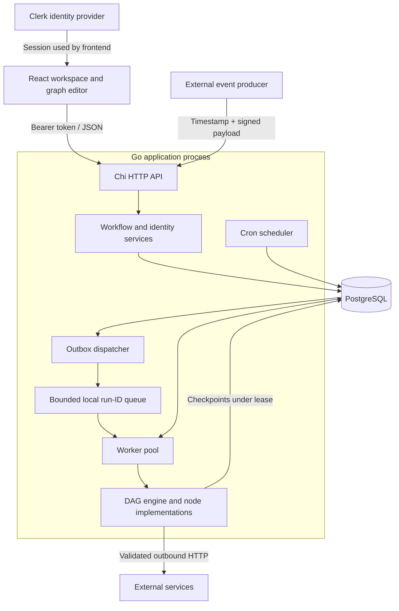
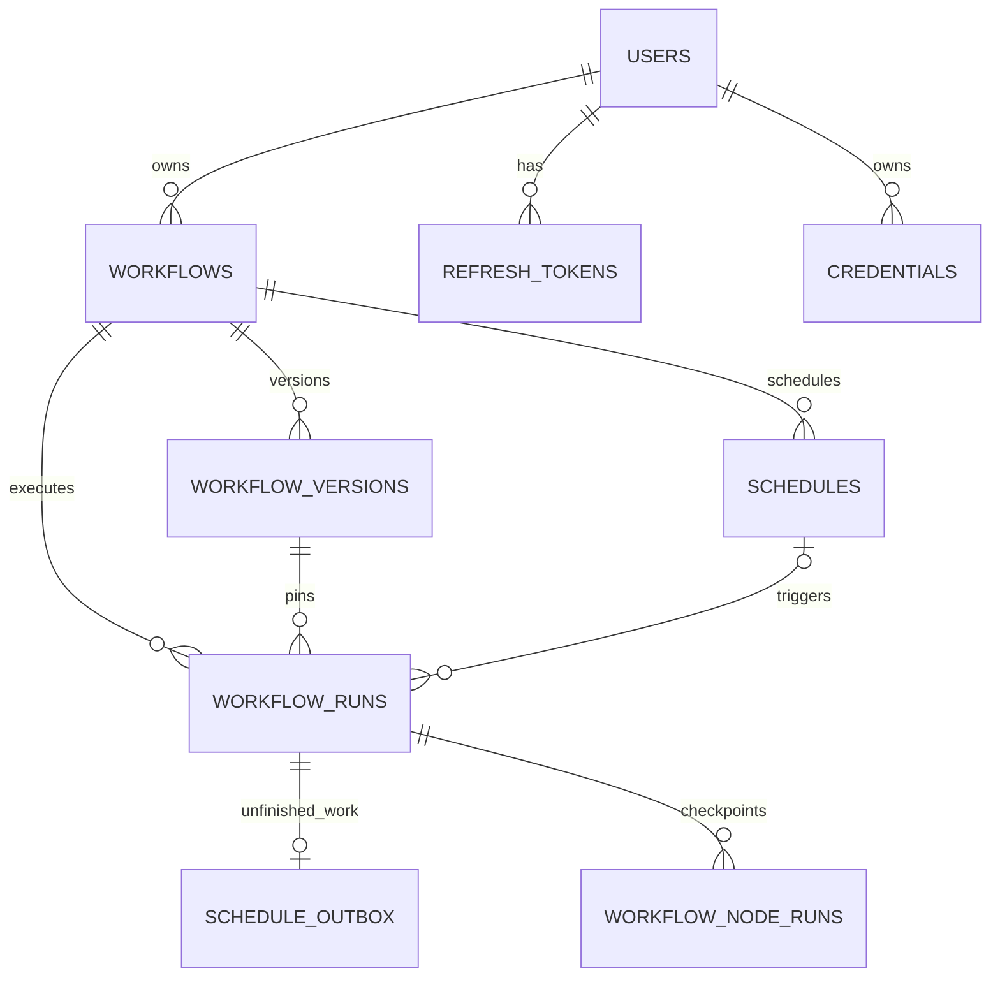

# Automata system design

This document describes the current implementation, its guarantees, and its limits.
Future improvements are explicitly separated from implemented behavior. See the
[backend guide](README.md) for configuration, API routes, source layout, and commands.

## 1. Problem and requirements

Automata lets an authenticated user build a visual automation, save it, and execute
it through manual actions, signed webhooks, or cron schedules. Users need reliable
status inspection, reusable node outputs after failure, and isolation from other
users' workflows.

The implementation prioritizes:

1. Durable acceptance: an accepted job must not depend on one process's memory.
2. Version consistency: later edits must not change an already-admitted run.
3. Recoverability: completed nodes should not be repeated after a worker restart.
4. Ownership enforcement: callers cannot access resources by guessing an ID or email.
5. Bounded resource consumption: queues, admission, graph sizes, and payloads have limits.
6. Operability with a small deployment: one application executable and PostgreSQL.

It does not promise exactly-once external side effects, real-time cron precision,
arbitrary code execution, parallel nodes within one graph, or unlimited workflow duration.

## 2. Deployment topology



API, scheduler, dispatcher, and workers are logical components within the same
process, not independently deployed microservices. Multiple instances may share
one PostgreSQL database; each instance has its own loops, queue, workers, and pool.

PostgreSQL stores definitions, execution state, and durable jobs. Local queue
entries are hints pointing at that state. There is no separate message broker.
Clerk is optional at the backend configuration level, but the normal frontend uses it.

In development, Vite proxies `/api` to the Go listener. In production, a reverse
proxy should terminate TLS and route requests to the application. PostgreSQL should
be reachable only from trusted application/administration infrastructure. The supplied
Compose files provide a database, not a complete production deployment.

## 3. Domain model and data relationships



A workflow is the stable identity containing owner and webhook secret. A workflow
version is a graph snapshot. A run references one version and stores trigger,
status, result, and timestamps. Node checkpoints are keyed to the run and node.
Schedules refer to a workflow, choosing a version at admission time.

Despite its name, `schedule_outbox` holds manual and webhook jobs as well as cron
jobs. An outbox entry means durable work has not yet been acknowledged, even if a
worker has already written some successful checkpoints.

Credentials are owned separately from workflows. Graphs contain credential IDs,
not secret values. The reference is resolved at execution time; rotating a secret
can therefore affect a later attempt of an already-admitted graph. Graph version
pinning does not pin the historical value of a credential.

API-key and audit-log tables exist but are not an implemented authentication mode
or a comprehensive audit trail in the current request pipeline.

## 4. Request boundaries and identity

Requests pass through recovery, request IDs, request logging, timeout handling,
CORS, and body limits. Protected route groups also apply the configured authentication
middleware. Auth and webhook routes have local IP throttles.

The identity boundary is the bearer token, not a submitted email. In Clerk mode,
the backend verifies the token, session identity, and authorized party, then maps
the subject to a local user. In legacy mode, a signed JWT supplies local identity
after password verification at login. Resource queries and services enforce ownership.

CORS is a browser access policy; it is not authentication. Webhooks intentionally
do not require a user bearer token, but require a workflow-specific signature.
The webhook secret is accessible to the workflow's authenticated owner.

Clerk mappings are not linked to existing accounts just because emails match.
This avoids treating knowledge of an email as authority to claim local resources.
Clerk sign-in strategy settings remain external configuration, not frontend CSS or
an API parameter controlled by the caller.

## 5. Saving and versioning

Creating a workflow and its initial version happens in one transaction. Failure to
insert the version rolls back the workflow, avoiding unusable graph-less records.

Updating a workflow checks owner identity, updates metadata, and inserts the next
version in a transaction. The workflow-row update serializes competing edits so
version numbers can advance safely. This is not a collaborative merge protocol:
there is no user-facing optimistic edit conflict token, and concurrent editors can
publish successive versions with different content.

An admitted run stores a version ID. Workers load that snapshot, so editing the
workflow does not mutate execution already in progress. A later run uses the latest
version selected by its admission path.

## 6. Admission and execution sequence

```mermaid
sequenceDiagram
  participant Caller
  participant API
  participant PG as PostgreSQL
  participant D as Dispatcher
  participant W as Worker
  participant E as External service
  Caller->>API: Execute workflow / signed webhook
  API->>API: Validate identity, ownership or signature, workflow state
  API->>PG: Begin admission transaction
  API->>PG: Shared advisory lock; check owner/global quotas
  API->>PG: Insert version-pinned run and outbox row
  PG-->>API: Commit
  API-->>Caller: Run record
  D->>PG: Poll eligible outbox IDs
  D->>W: Enqueue local run ID
  W->>PG: Claim outbox row with token + expiry
  PG-->>W: Graph, payload seed, owner
  W->>PG: Commit node attempt
  W->>E: Perform node action
  E-->>W: Result
  W->>PG: Commit successful node output
  W->>W: Resolve branches and next node
  W->>PG: Commit final run result + remove outbox row
```

Returning a run record means durable admission, not successful completion. The
frontend polls run inspection endpoints for progress.

Admission uses one transaction-scoped PostgreSQL advisory lock across instances.
Inside it, the service checks global and owner outstanding work and the owner's
rolling run rate, then inserts the run and outbox together. This prevents concurrent
requests from all passing a quota check before their inserts become visible.

The design favors simple correctness over maximum admission throughput. It creates
a potential serialization bottleneck under high enqueue volume. The lock is not
held during node execution.

Owner limits produce `429`; global backlog exhaustion produces `503`, with retry
information. Rejected cron work stays due instead of disappearing. Local queues
can fill without deleting durable jobs; the dispatcher can discover those IDs again.

## 7. Scheduling semantics

The scheduler uses five-field cron expressions and polls every 30 seconds after
an initial startup tick. For a due schedule, a transaction locks the occurrence,
checks eligibility, selects a version, admits a run, inserts durable work, and
advances the schedule. Competing instances use locking and occurrence uniqueness
to avoid creating multiple run records for the same schedule occurrence.

The next occurrence is calculated from current time. This coalesces downtime into
a resumed occurrence rather than replaying every missed interval. A 30-second
polling interval means cron should not be described as precise-to-the-second dispatch.

A failed admission transaction does not advance the schedule. Inactive workflows
or missing versions leave schedules due and generate errors. Deactivating a schedule
stops future scheduling; it does not cancel a run already admitted.

## 8. Claims, heartbeats, and fencing

Workers claim only after removing an ID from the local queue. Waiting in memory
does not consume a lease. A claim uses `FOR UPDATE SKIP LOCKED`, a fresh random
token, and a 30-second expiration. Lease heartbeats run about every ten seconds.

The claim transaction commits before the graph starts. A database connection is
not held open while waiting on HTTP or delay nodes. Short transactions handle
claims, renewals, checkpoints, and final acknowledgement.

Fencing means each mutation verifies the current lease token. If worker A pauses,
its lease expires, and worker B claims the run, A cannot overwrite B's progress
when it resumes. A detected lease loss cancels A's execution context.

Fencing protects database state. It cannot revoke an HTTP request already accepted
by an external system. This distinction is why fenced leases do not imply exactly-once
external effects.

## 9. DAG traversal, branches, and mappings

The engine validates the graph, builds outgoing edges and predecessor counts, and
queues roots. It executes active nodes in dependency order. For each completed or
skipped predecessor, it resolves outgoing edges and decrements successor counts.

A join becomes ready once every incoming edge is resolved. It executes once if
at least one incoming edge is active. Fully inactive branches remain skipped.
Stored successful outputs are reused during recovery, preserving branch decisions.

Mappings resolve output paths from upstream nodes into configuration values.
They preserve JSON types. A reference to a skipped or unavailable output fails the
consumer before its node action. Validation prevents references to non-upstream nodes.

Concurrency exists across workflow executions, not across nodes within one graph.
The default four workers therefore run up to four workflows per process. Long
HTTP calls, delay nodes, and retry backoff consume those slots.

## 10. Retry and side-effect guarantees

Before executing a node, its attempt count is committed. Success is checkpointed
before executing successors. This creates three meaningful recovery cases:

| Persisted state | Recovery behavior |
|---|---|
| Successful output exists | Reuse output; do not execute that node again |
| Attempt started but no success checkpoint | Outcome may be unknown; consumed attempt still counts |
| Recorded retryable failure with budget remaining | Retry only that node, respecting persisted retry deadlines |

Each node defaults to one total attempt. Opt-in policies permit up to five attempts.
An exhausted attempt budget after interruption fails rather than silently repeating
an uncertain action. Ordinary fixed backoff can be lost on restart; HTTP Retry-After
minimum deadlines are persisted. A worker execution has a 60-second deadline,
renewed on recovery, not one lifetime deadline for the run.

HTTP nodes use a stable `Idempotency-Key` derived from run/node identity. It is
stable across attempts but different for a separately admitted run. The destination
must honor the key and retain deduplication state for it to prevent duplicate effects.

There is no atomic transaction spanning PostgreSQL and external APIs. An external
write can succeed immediately before the process dies or checkpoint storage fails.
Recovery may retry it if budget remains. Consequently the system provides durable
job recovery with bounded attempts, not unconditional at-least-once success or
exactly-once side effects.

Separate webhook deliveries and repeated manual submissions create distinct runs.
HMAC protects webhook authenticity, not delivery deduplication. Applications needing
business-event deduplication must implement it explicitly.

## 11. Workflow deletion

Deletion is an authenticated owner operation, not merely removing a UI card.
The repository locks the owned workflow, coordinates with schedules using nonblocking
row locks, and checks for pending/running runs or any outstanding outbox work.
Busy workflows cannot be deleted. A scheduler lock conflict can require retrying.

The parent lock and PostgreSQL foreign-key checks coordinate concurrent insertion
of dependent run records. Deleting the workflow cascades to versions, schedules,
run history, and checkpoints. Shared credentials belong to the user and remain.

The API returns `204` with no JSON body. The frontend then closes the confirmation,
removes the workflow and dependent local state, and stays in its existing section.
It tracks locally deleted IDs so an older polling response cannot restore a removed
card. Failed requests leave the dialog open with a visible error; they do not remove
local data. A client timeout is ambiguous: refresh before assuming deletion failed.

Deletion is permanent and does not reverse effects already performed outside
Automata. There is no recycle bin or undo transaction.

## 12. Failure matrix

| Failure point | Durable consequence / recovery |
|---|---|
| API fails before admission commit | Run/outbox insertion rolls back |
| API commits but response is lost | Job exists; blind resubmission can create another run |
| Dispatcher or local queue disappears | Committed outbox entries survive and are rediscovered |
| Worker dies after claim | Lease expires; another worker may reclaim |
| Worker loses lease | Context is cancelled; stale database writes are fenced |
| External action succeeds before checkpoint | Outcome is uncertain; deduplication depends on destination |
| Node checkpoint write fails | Durable job is retained for recovery |
| Final acknowledgement fails | Successful node checkpoints remain available |
| PostgreSQL unavailable | Admission/state changes cannot safely proceed; execution progress may stop |
| Credential encryption key changes | Existing ciphertext cannot be read with the new key |
| Old server binary remains running | New frontend actions may encounter missing routes |
| Browser refreshes during execution | Run persists; inspection can resume by fetching its ID |

Timeouts and disconnects can leave callers unsure whether a commit succeeded.
Do not describe client retries as idempotent when no request deduplication key exists.

## 13. Security and trust boundaries

The browser is untrusted. Roles and ownership are not accepted from arbitrary client
metadata. Protected routes verify a token; repository/service ownership checks
bind operations to the authenticated user.

External webhook producers know only the secret for their workflow. The timestamp
and HMAC protect against unsigned calls and old deliveries, while allowing replay
inside the accepted time window.

The HTTP node is a potential SSRF boundary. It validates destination addresses and
DNS answers, connects through checked IPs, validates redirects, rejects URL userinfo,
and disables environment proxy routing. Infrastructure egress policy remains an
additional deployment control.

Credential ciphertext is bound to owner/credential identity. Exact HTTPS host/port
restrictions and disabled redirects limit where the secret can be sent. Redaction
covers supported representations of the selected secret, not all sensitive input
or output. Ordinary workflow payloads and results remain sensitive database content.

Only trusted proxies may influence forwarded client IPs. Per-process IP throttles
are distinct from shared database quotas; adding application instances increases
the aggregate allowance of local IP throttles.

## 14. Scaling and performance tradeoffs

Horizontal scaling adds API capacity and worker slots, while shared leases and
transactional admission coordinate jobs. All replicas need compatible schemas,
auth configuration, credential keys, and admission limits.

Likely constraints to measure before scaling:

- Admission serialization and SQL count queries under high enqueue volume.
- PostgreSQL pool connections across every replica, not only one process.
- Checkpoint write rate as graphs gain nodes and retries.
- Repeated eligible-ID polling by multiple dispatchers.
- Worker occupancy from external latency, delay nodes, and retry waits.
- Storage growth from versions, payloads, outputs, and execution history.
- Frontend polling and listing behavior as workflow counts increase.

The architecture avoids broker operations and distributed queue/database commit
coordination, but shifts queue and checkpoint load onto PostgreSQL. Published demo
latencies are local baselines, not production capacity guarantees. Benchmark with
representative node workloads, database latency, concurrency, and payload sizes.

## 15. Operations, observability, and recovery

Zap logs and request IDs provide current diagnostic visibility. `/healthz` checks
connectivity; it is not a full scheduler/worker readiness or backlog monitor.
There is no implemented metrics exporter or distributed tracing pipeline.

Production operations should monitor admission errors, queue age, pending jobs,
lease churn, failure rates, checkpoint latency, database pool saturation, and
external dependency latency. These are recommended monitoring targets, not claims
that dashboards or alerts already exist in the repository.

Apply migrations once with a migration role. Stop incompatible workers during
schema/semantic upgrades, then restart matching binaries. Startup checks catch
specific missing fields but do not replace the deployment procedure.

Back up PostgreSQL and separately protect the credential encryption key. Verify
restoration into an isolated database before relying on backups. A logical backup
is not point-in-time recovery; WAL archiving/managed recovery requires separate
infrastructure. Restoring older state can also reintroduce jobs whose external
effects already occurred, so reconcile outstanding work before resuming workers.

## 16. Verification strategy and future work

Unit tests exercise graph validation, branching, retry behavior, mappings, HTTP
security, configuration, and queue/worker behavior. Database tests cover admission
concurrency, rollback, leases, fencing, checkpoints, refresh rotation, ownership,
and workflow deletion. Integration tests exercise API behavior against PostgreSQL.
Recovery tooling deliberately interrupts workers to test durable progress.

Full verification requires a dedicated migrated test database and race-enabled Go
tests. Browser tests need a working Chromium runtime; Clerk sign-in needs its own
configured identity test flow. Skipped suites must be reported separately from passes.

Potential future work, not currently implemented:

- Request/business-event deduplication for manual and webhook admission.
- Durable long waits that release workers and a supported cancellation protocol.
- Retention policies and explicit deletion/archival policy for operational history.
- Metrics, tracing, audit capture, and actionable worker readiness checks.
- Team ownership, shared permissions, and OAuth connection management.
- Separate API/worker deployment roles if workload measurements justify them.
- Optimistic editing conflicts and parallel graph execution with defined join semantics.

These changes need explicit data models and correctness tests; they should not be
inferred from the existence of an enum, table, or frontend control.

This document intentionally contains no live credentials, private endpoints, account
identifiers, or production database contents. It is suitable for source control.
